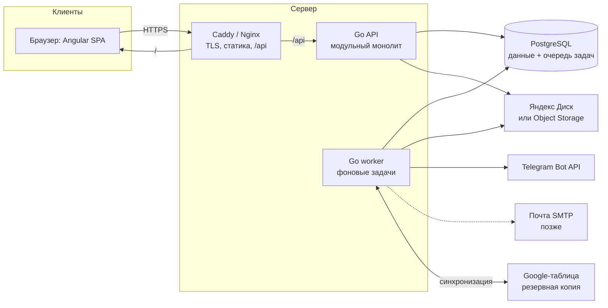
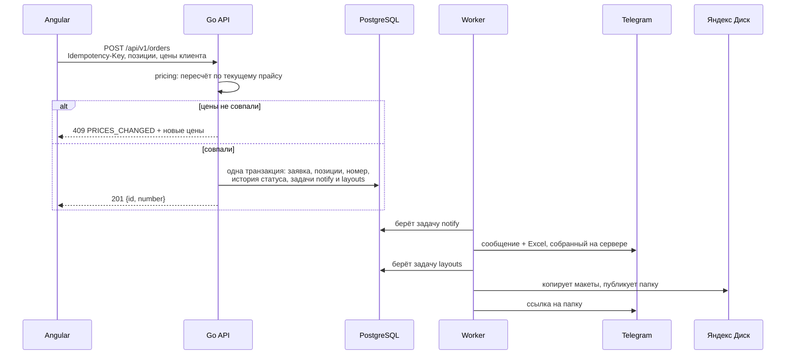
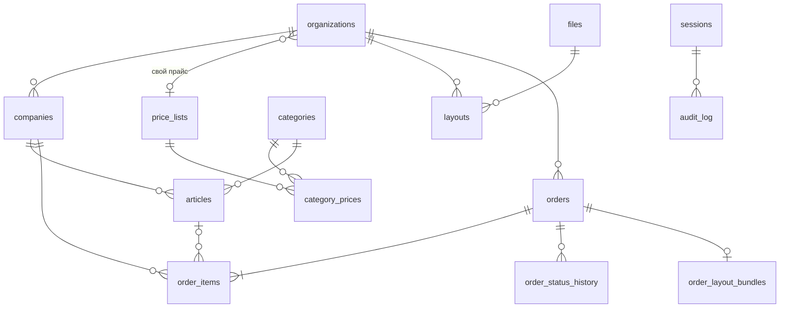
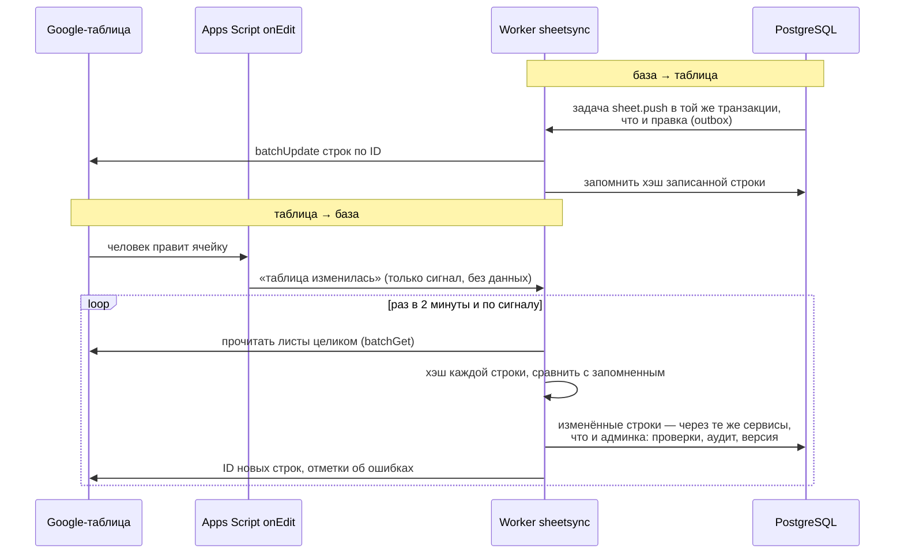

# План развития платформы FB Print

Дата: 19.11.2026. Статус: черновик для обсуждения.

Цель: перенести калькулятор с Google Sheets и Apps Script на свой бэкенд на Go с PostgreSQL, перевести фронтенд на Angular и заложить основу под рост: свои прайсы, новые продукты, интеграции, а позже — личные входы клиентов. Пока вход остаётся по двум общим паролям, клиентскому и админскому. Google-таблица остаётся резервной копией с синхронизацией в обе стороны.

## 1. Что есть сейчас

| Часть | Как устроено | Объём |
| --- | --- | --- |
| Фронтенд | Статика на GitHub Pages, ES-модули без сборки, `tokens.css` + `style.css` | ~4 000 строк JS |
| Бэкенд | Один Apps Script: роутер `doPost` по полю `action`, 15 действий | ~2 600 строк |
| Данные | Google Sheets: «Категории», два листа артикулов, «Заявки», «Позиции заявок» | ~400 артикулов, ~40 категорий |
| Файлы | Яндекс Диск: папка макетов, папки заявок | ~400 файлов |
| Уведомления | Telegram-бот, Excel заявки во вложении | — |
| Доступ | Два общих пароля: клиентский и админский | — |
| Тесты | `node:test`, Apps Script гоняется в `node:vm` с подделками | 20 файлов |

Что работает хорошо и что нужно сохранить:

- правила тиража и цены (`js/pricing.js`): три зоны тиража, кратность, срочность;
- проверка цен на сервере и пометки расхождений менеджеру;
- защита от повторной заявки (`requestId`);
- загрузка заявки из Excel клиента;
- сборка папки макетов в фоне с повторами;
- тексты ошибок словами таблицы;
- дизайн-токены.

### Ограничения, которые упираются в текущую платформу

1. **Один пароль на всех клиентов.** Каждый клиент видит все заявки всех клиентов, нельзя понять, кто отправил заявку. **Решение на сейчас: оставляем.** Переезд сохраняет два общих пароля, клиентский и админский. Личные входы — заготовка на будущее (раздел 11).
2. **Таблица как база.** Правки идут по номеру строки. Защита — сравнение `originalSku` в строке. Над заголовками нельзя вставить строку. Нет внешних ключей, нет истории изменений.
3. **Цена считается в браузере.** Сервер только сверяет и помечает. Подделанная заявка всё равно уходит менеджеру.
4. **Номер заявки — «максимум на листе + 1».** Удалили последнюю — номер выдаётся снова.
5. **Новая компания — правка кода** (массив `COMPANIES` в `Code.gs`).
6. **Нет истории цен.** Поменяли цену категории — старые заявки уже не сверить.
7. **Ограничения Apps Script:** холодный старт до нескольких секунд (тайм-аут на фронте 20 с), запуск триггера до 6 минут, нет HTTP-статусов (ошибка приходит с кодом 200), нет CORS (запрос идёт как `text/plain`), кэш до 100 КБ на значение.
8. **Excel для Telegram собирает браузер клиента.** Верить ему нельзя, верить можно только тексту сообщения.
9. **Нет аудита.** Кто удалил заявку или поменял цену — не видно.
10. **Публикация вручную:** скопировать `Code.gs` в редактор, выпустить новую версию развертывания.

## 2. Целевая архитектура

### Принципы

- **Модульный монолит, а не микросервисы.** Нагрузка маленькая: десятки заявок в день. Один бинарник на Go проще разворачивать, отлаживать и менять. Модули разделены внутри кода, чтобы потом при необходимости вынести любой из них.
- **PostgreSQL — единственное хранилище состояния.** Очередь фоновых задач тоже в нём. Redis и брокер сообщений не нужны.
- **Сервер — источник правды для цен.** Фронт считает цену для мгновенного отклика, но заявку оценивает сервер.
- **Контракт API описан в OpenAPI.** Из него генерируются сервер на Go и клиент для Angular. Расхождение фронта и бэка ловит компилятор.
- **Фронт и API на одном домене.** `https://<домен>/` — Angular, `https://<домен>/api/` — Go. Нет CORS, сессия в cookie.
- **Внешние сервисы — за интерфейсами.** Яндекс Диск, Telegram, почта подключаются адаптерами. Замена одного на другое не трогает бизнес-логику.

### Схема



API и worker — один бинарник с разными режимами запуска (`fbprint api`, `fbprint worker`). На старте их можно запускать в одном процессе.

### Модули бэкенда

| Модуль | За что отвечает | Сейчас в `Code.gs` |
| --- | --- | --- |
| `access` | вход по общему паролю, роль, сессии; позже — пользователи и организации | `checkPassword`, `passwordRole` |
| `catalog` | компании, категории, артикулы, импорт артикулов из Excel | `readCatalog`, `saveArticle`, `saveCategory`… |
| `pricing` | чистые правила тиража и цены, без базы и HTTP | `verifyPrices`, `lineWarnings`; на фронте `pricing.js` |
| `pricelists` | прайсы, цены категорий с датами действия | цены на листе «Категории» |
| `orders` | черновик → заявка, нумерация, статусы, история статусов, Excel заявки | `reserveOrderRow`, `writeOrderLines`, `readOrders`… |
| `layouts` | файлы макетов, привязка к артикулам, сборка папки заявки | весь блок «Макеты на Яндекс Диске» |
| `notify` | уведомления: Telegram сейчас, почта и вебхуки потом | `sendTelegram`, `layoutsMessage` |
| `files` | хранилище файлов: адаптеры Яндекс Диска и S3 | `diskRequest`, `uploadDiskFile` |
| `audit` | журнал действий: кто, что, когда, было → стало | нет |
| `sheetsync` | двусторонняя синхронизация с Google-таблицей (раздел 7) | нет: сейчас таблица и есть база |
| `platform` | конфиг, логи, HTTP-сервер, база, миграции, очередь задач, метрики | — |

Правило зависимостей: модули общаются через интерфейсы сервисов, а не через чужие таблицы. `pricing` ни от кого не зависит. `orders` зависит от `catalog`, `pricelists`, `pricing`. Внешние вызовы (`notify`, `layouts`) запускаются только фоновыми задачами, никогда внутри HTTP-запроса клиента.

### Ключевые потоки

**Отправка заявки.**



Отличия от сегодняшнего:

- заявка с подделанной ценой не принимается, а получает новые цены; клиент видит «цены изменились» и подтверждает;
- заявка сохраняется до отправки в Telegram; сбой Telegram не теряет заявку и не откатывает её, задача повторяется;
- задачи ставятся в той же транзакции, что и заявка (паттерн outbox): заявка без уведомления невозможна;
- Excel для менеджера собирает сервер из сохранённых позиций, ему можно верить.

**Вход.** Как сейчас: два общих пароля, клиентский и админский. Разница в том, что пароль отправляется один раз. Сервер сверяет его, определяет роль и создаёт сессию в базе → cookie `HttpOnly; Secure; SameSite=Lax`. Пароль больше не лежит в `localStorage` и не уходит с каждым запросом. Сменили пароль — старые сессии этой роли закрываются.

Сессия хранит только роль (`client` или `admin`). Когда появятся личные входы, в сессию добавится пользователь, а остальной код не изменится: он и так спрашивает роль у сессии.

## 3. Бэкенд на Go

### Стек

| Задача | Выбор | Почему |
| --- | --- | --- |
| Язык | последняя стабильная Go | — |
| HTTP | `net/http` (маршруты с методами и параметрами из стандартной библиотеки) или `chi` | меньше зависимостей |
| Контракт | OpenAPI 3.1 + `oapi-codegen` (strict server) | типы запросов и ответов из одной спецификации |
| База | PostgreSQL 17+, драйвер `pgx/v5` | — |
| SQL | `sqlc` — запросы пишутся на SQL, Go-код генерируется | видно каждый запрос, нет ORM-магии |
| Миграции | `goose` (SQL-файлы) | простые, версионируются в git |
| Фоновые задачи | `river` (очередь на PostgreSQL) | постановка задачи в той же транзакции, повторы, расписание |
| Логи | `log/slog`, JSON | стандартная библиотека |
| Пароли | `argon2id` (`golang.org/x/crypto`) | — |
| Excel | `excelize` | серверный Excel заявки |
| Конфиг | переменные окружения | секреты не в коде |
| Тесты | `testing` + `testcontainers-go` для PostgreSQL | интеграционные тесты на настоящей базе |
| Линтер | `golangci-lint` | — |

### Структура репозитория

Один репозиторий для фронта и бэка: контракт API и общие тестовые данные лежат рядом.

```text
/
├─ api/
│  └─ openapi.yaml            # контракт: источник для Go и TypeScript
├─ contracts/
│  └─ pricing-cases.json      # общие примеры расчёта: их проверяют тесты Go и Angular
├─ backend/
│  ├─ cmd/fbprint/main.go     # api | worker | migrate | import-sheets
│  ├─ internal/
│  │  ├─ platform/            # config, db, httpserver, auth middleware, jobs
│  │  ├─ access/
│  │  ├─ catalog/
│  │  ├─ pricing/             # чистые функции, без зависимостей
│  │  ├─ pricelists/
│  │  ├─ orders/
│  │  ├─ layouts/
│  │  ├─ notify/
│  │  ├─ files/               # yadisk/, s3/
│  │  ├─ audit/
│  │  ├─ sheetsync/
│  │  └─ legacy/              # временный фасад старого API (раздел 6)
│  ├─ db/
│  │  ├─ migrations/
│  │  └─ queries/             # SQL для sqlc
│  └─ Dockerfile
├─ frontend/                  # Angular
├─ legacy/                    # текущий сайт и Apps Script до выключения
└─ deploy/                    # docker-compose, Caddyfile
```

Внутри модуля: `service.go` (бизнес-логика), `store.go` (доступ к базе через sqlc), `http.go` (обработчики), `jobs.go` (фоновые задачи), `*_test.go`.

### API

REST, JSON, префикс `/api/v1`. Ошибки — по RFC 9457 (`application/problem+json`) с полем `code`, как сейчас (`ARTICLE_CHANGED`, `CATEGORY_IN_USE`…), и `detail` по-русски для показа пользователю. HTTP-статусы настоящие: 400, 401, 403, 404, 409, 422, 429.

| Метод и путь | Что делает | Сейчас |
| --- | --- | --- |
| `POST /auth/login`, `POST /auth/logout`, `GET /me` | вход по общему паролю, выход, текущая роль | пароль в каждом запросе |
| `GET /catalog` | компании, категории, артикулы и цены; `ETag` | `catalog` |
| `POST /quotes` | пересчёт списка позиций по текущему прайсу | `verifyPrices` |
| `POST /orders` | новая заявка, заголовок `Idempotency-Key` | `order` |
| `GET /orders?status=&cursor=` | список заявок, постранично | `orders` (до 500 разом) |
| `GET /orders/{id}` | заявка с позициями и историей статусов | `orderLines` |
| `GET /orders/{id}/excel` | Excel заявки с сервера | собирает браузер |
| `PATCH /admin/orders/{id}/status` | смена статуса | `setOrderStatus` |
| `DELETE /admin/orders/{id}` | мягкое удаление | `deleteOrder` (удаление строк) |
| `POST /admin/orders/{id}/layout-bundle/rebuild` | пересобрать папку макетов | `rebuildLayouts` |
| `GET/POST/PATCH/DELETE /admin/categories` | категории | `categoryRows`, `saveCategory`, `deleteCategory` |
| `GET/POST/PATCH/DELETE /admin/articles` | артикулы; `POST /admin/articles/import` — из Excel | `articleLayouts`, `saveArticle`, `deleteArticle` |
| `PUT /admin/articles/{id}/layout` | загрузка макета, `multipart/form-data` | `uploadLayout` (base64 в JSON) |
| `GET /admin/layouts/{id}/preview?size=M` | превью картинкой, с кэшем | `layoutPreviews` (data-URL в JSON) |
| `/admin/companies`, `/admin/price-lists` | компании, прайсы | правка `COMPANIES` в коде |
| `PUT /admin/passwords/{role}` | смена общего пароля из админки | свойства скрипта |
| `GET /admin/audit` | журнал действий | нет |

Защита от одновременной правки: у категории и артикула поле `version`. Клиент присылает его в `If-Match`. Не совпало — `409 *_CHANGED`. Это замена сегодняшней проверки «в строке уже другой артикул».

### Расчёт цены в двух местах

Правила цены живут в Go (`internal/pricing`) — это источник правды. Angular держит копию на TypeScript, чтобы цена менялась без запроса при каждом нажатии «+».

Чтобы копии не разошлись, в `contracts/pricing-cases.json` лежат примеры: категория, тираж, срочность → статус, цена, подсказка. Их прогоняют тесты обеих сторон. Новое правило без нового примера не проходит ревью. Сегодняшние тесты `tests/pricing.test.js` — основа для этих примеров.

Альтернатива — считать только на сервере через `POST /quotes` с задержкой ввода. Проще, но каждое нажатие «+» — запрос. Для калькулятора это хуже.

### Безопасность

- общие пароли хранятся хэшем `argon2id` в `settings`; вход ограничен по частоте на IP, неверный пароль — с задержкой, как сейчас;
- админский пароль должен отличаться от клиентского: сервер не даст сохранить одинаковые;
- сессия — случайный токен 32 байта, в базе лежит его хэш; срок 30 дней, продлевается при работе; смена пароля закрывает сессии этой роли;
- CSRF: `SameSite=Lax` и обязательный заголовок `X-Requested-With` на изменяющих запросах;
- проверка роли — в одном месте, в промежуточном обработчике для всех путей `/admin/*`; тест проверяет, что каждый такой путь с клиентской сессией отвечает `403`;
- загрузка файлов: проверка типа по содержимому, а не по имени; лимит 20 МБ;
- секреты (токены Telegram и Яндекс Диска, пароль базы) — в переменных окружения или менеджере секретов облака;
- ловушка `website` и лимит заявок — остаются; капча — только если появится спам.

### Персональные данные

С общими паролями сайт персональные данные не собирает, как и сейчас. В журнале и сессиях хранится IP-адрес — его стоит хранить не дольше 90 дней.

Когда появятся личные входы, почта и имя станут персональными данными по 152-ФЗ. Тогда понадобятся хостинг в России, уведомление Роскомнадзора и политика обработки на сайте. Поэтому хостинг в России выбираем сразу, чтобы потом не переезжать.

## 4. База данных

### Сущности

- **Организация** (`organizations`) — клиент FB Print. Пока одна строка: все, кто входит по клиентскому паролю. Таблица — заготовка: когда появятся личные входы, у каждого клиента будет своя организация, а компании, заявки и макеты уже привязаны к ней.
- **Компания** (`companies`) — юрлицо или бренд, для которого печатают этикетки. Сегодняшние `global_food` и `studio_vkusa`. Своя площадка (`ГФ`, `СВ`) и свой список артикулов.
- **Сессия** (`sessions`) — вход по общему паролю, хранит роль.
- **Категория** (`categories`) — производственная категория: размер, цветность, минимум, кратность, ручьи, сниженный тираж.
- **Прайс** (`price_lists`) и **цены категорий** (`category_prices`) — цены с датами действия. Есть прайс по умолчанию; организации можно назначить свой.
- **Артикул** (`articles`) — товар компании: код, наименование, категория.
- **Макет** (`layouts`) — текущий файл макета для кода артикула внутри организации. Один код — один макет, как сейчас.
- **Файл** (`files`) — любой файл в хранилище.
- **Заявка** (`orders`) и **позиции** (`order_items`) — со снимком цены и категории на момент заявки.
- **История статусов**, **сборка папки макетов**, **журнал действий**, **настройки**.

### Диаграмма



### Таблицы (PostgreSQL)

Перечисления хранятся как `text` с `CHECK`, а не как тип `enum`: новое значение добавляется простой миграцией.
Деньги — `numeric`, не `float`. Цена категории хранится с четырьмя знаками, как в таблице (`1.125`). Цена в позиции заявки — уже округлённая до копеек.

```sql
-- расширения
create extension if not exists btree_gist;

-- Доступ ---------------------------------------------------------------

create table organizations (
  id             uuid primary key default gen_random_uuid(),
  name           text not null,
  status         text not null default 'active' check (status in ('active', 'blocked')),
  price_list_id  uuid,                         -- null = прайс по умолчанию
  created_at     timestamptz not null default now(),
  updated_at     timestamptz not null default now()
);

-- Общие пароли — в settings: ключи 'access.client_password_hash' и 'access.admin_password_hash'.

create table sessions (
  token_hash        bytea primary key,
  role              text not null check (role in ('client', 'admin')),
  organization_id   uuid not null references organizations(id),  -- пока всегда единственная организация
  password_version  int not null,             -- смена пароля роли повышает версию и закрывает старые сессии
  created_at        timestamptz not null default now(),
  expires_at        timestamptz not null,
  last_seen_at      timestamptz not null default now(),
  ip                inet,
  user_agent        text
);
-- Личные входы (позже): таблицы users, memberships, auth_tokens и колонка sessions.user_id.

-- Каталог --------------------------------------------------------------

create table companies (
  id               uuid primary key default gen_random_uuid(),
  organization_id  uuid not null references organizations(id),
  code             text not null unique,       -- 'global_food': ключ из старого API
  name             text not null,
  short_label      text not null,              -- 'ГФ', 'СВ'
  sort_order       int not null default 0,
  archived_at      timestamptz
);

create table categories (
  id             uuid primary key default gen_random_uuid(),
  number         int not null unique,          -- «номер категории» из колонки A
  product_type   text not null default 'label',-- заготовка под другие продукты
  size_label     text not null,                -- '80 х 120'
  width_mm       numeric(7,2),                 -- разобранный размер: для фильтров и имён файлов
  height_mm      numeric(7,2),
  color          text not null,
  minimum_qty    int not null check (minimum_qty > 0),
  multiple       int not null check (multiple > 0),
  roll_qty       int check (roll_qty > 0),
  lanes          int check (lanes > 0),
  reduced_min    int check (reduced_min > 0),
  reduced_max    int,
  attributes     jsonb not null default '{}',  -- материал, клей, намотка — когда понадобятся
  version        int not null default 1,
  archived_at    timestamptz,
  created_at     timestamptz not null default now(),
  updated_at     timestamptz not null default now(),
  check (reduced_min is null or (reduced_max is not null and reduced_min <= reduced_max and reduced_max < minimum_qty))
);

create table price_lists (
  id          uuid primary key default gen_random_uuid(),
  name        text not null,
  is_default  boolean not null default false,
  currency    char(3) not null default 'RUB'
);
create unique index price_lists_one_default on price_lists (is_default) where is_default;

alter table organizations
  add foreign key (price_list_id) references price_lists(id);

create table category_prices (
  id             uuid primary key default gen_random_uuid(),
  price_list_id  uuid not null references price_lists(id),
  category_id    uuid not null references categories(id),
  standard       numeric(12,4) not null check (standard > 0),
  urgent         numeric(12,4) not null check (urgent > 0),
  emergency      numeric(12,4) not null check (emergency > 0),
  reduced        numeric(12,4) check (reduced > 0),
  valid          tstzrange not null default tstzrange(now(), null),
  -- у категории в одном прайсе в каждый момент одна цена
  exclude using gist (price_list_id with =, category_id with =, valid with &&)
);

create table articles (
  id           uuid primary key default gen_random_uuid(),
  company_id   uuid not null references companies(id),
  sku          text not null check (sku ~ '^[^\s_/\\]+$'),
  name         text not null,
  category_id  uuid references categories(id),  -- null = артикул не готов, на сайте не виден
  size_label   text not null default '',
  color        text not null default '',
  run_note     text not null default '',        -- колонка G «Тираж» листа артикулов
  version      int not null default 1,
  deleted_at   timestamptz,
  created_at   timestamptz not null default now(),
  updated_at   timestamptz not null default now()
);
create unique index articles_company_sku on articles (company_id, sku) where deleted_at is null;

-- Файлы и макеты -------------------------------------------------------

create table files (
  id             uuid primary key default gen_random_uuid(),
  storage        text not null check (storage in ('yadisk', 's3')),
  storage_key    text not null,                 -- путь на Диске или ключ объекта
  original_name  text not null,
  mime_type      text not null,
  size_bytes     bigint not null,
  sha256         bytea,
  created_at     timestamptz not null default now(),
  deleted_at     timestamptz,
  unique (storage, storage_key)
);

create table layouts (                          -- макет кода артикула внутри организации
  id               uuid primary key default gen_random_uuid(),
  organization_id  uuid not null references organizations(id),
  sku              text not null,
  file_id          uuid not null references files(id),
  is_current       boolean not null default true,
  created_at       timestamptz not null default now()
);
create unique index layouts_current on layouts (organization_id, sku) where is_current;

-- Заявки ---------------------------------------------------------------

create sequence order_number_seq;               -- номера не повторяются никогда

create table orders (
  id                uuid primary key default gen_random_uuid(),
  number            int not null unique default nextval('order_number_seq'),
  organization_id   uuid not null references organizations(id),
  status            text not null default 'submitted'
                    check (status in ('submitted', 'in_production', 'shipped', 'cancelled')),
  total             numeric(14,2) not null,
  items_count       int not null,
  price_list_id     uuid references price_lists(id),
  idempotency_key   text,
  source            text not null default 'web' check (source in ('web', 'excel', 'legacy', 'api')),
  submitted_at      timestamptz not null default now(),
  deleted_at        timestamptz,
  unique (organization_id, idempotency_key)
);
create index orders_org_time on orders (organization_id, submitted_at desc) where deleted_at is null;

create table order_items (
  id                 uuid primary key default gen_random_uuid(),
  order_id           uuid not null references orders(id) on delete cascade,
  line_no            int not null,
  company_id         uuid not null references companies(id),
  article_id         uuid references articles(id),   -- артикул могут удалить; снимок ниже остаётся
  sku                text not null,
  article_name       text not null,
  category_snapshot  jsonb not null,                 -- размер, цветность, минимум, кратность на момент заявки
  quantity           int not null check (quantity > 0),
  urgency            text not null check (urgency in ('standard', 'urgent', 'emergency')),
  run_zone           text not null check (run_zone in ('regular', 'reduced')),
  unit_price         numeric(12,2) not null,
  line_total         numeric(14,2) not null,
  condition          text not null default '',
  unique (order_id, line_no)
);

create table order_status_history (
  id           bigint generated always as identity primary key,
  order_id     uuid not null references orders(id) on delete cascade,
  from_status  text,
  to_status    text not null,
  changed_by   text not null,                   -- 'admin', 'client', 'system', 'sheet'
  changed_at   timestamptz not null default now(),
  comment      text not null default ''
);

create table order_layout_bundles (
  order_id     uuid primary key references orders(id) on delete cascade,
  status       text not null check (status in ('queued', 'building', 'done', 'partial', 'empty', 'failed')),
  folder_path  text,
  public_url   text,
  problems     jsonb not null default '[]',     -- [{sku, company, kind: missing|conflict|notFound|lost, detail}]
  attempts     int not null default 0,
  last_error   text,
  updated_at   timestamptz not null default now()
);

-- Сервисное ------------------------------------------------------------

create table notification_channels (
  id       uuid primary key default gen_random_uuid(),
  kind     text not null check (kind in ('telegram', 'email', 'webhook')),
  target   text not null,                       -- chat_id, адрес почты, URL
  events   text[] not null,                     -- {'order.submitted', 'layouts.ready', 'layouts.alert'}
  active   boolean not null default true
);

create table audit_log (
  id           bigint generated always as identity primary key,
  actor_role   text not null,                   -- 'admin', 'client', 'system', 'sheet'
  session_id   bytea,                           -- хэш токена сессии: отличает одну сессию от другой
  action       text not null,                   -- 'category.update', 'order.delete'
  entity_type  text not null,
  entity_id    text not null,
  before       jsonb,
  after        jsonb,
  ip           inet,
  at           timestamptz not null default now()
);
create index audit_entity on audit_log (entity_type, entity_id, at desc);

create table settings (                         -- порог доставки, коэффициенты, лимиты
  key         text primary key,
  value       jsonb not null,
  updated_at  timestamptz not null default now()
);
```

Таблицы очереди задач создаёт `river` своей миграцией.

### Решения по схеме

- **Номер заявки** — последовательность PostgreSQL. Номер не выдаётся повторно даже после удаления. Вид `FB-0042 от 09.11.2026` собирается из `number` и `submitted_at` по Москве. Перенесённые заявки сохраняют свои номера, последовательность стартует после самого большого.
- **Удаление заявки** — мягкое (`deleted_at`). Список её не показывает, аудит и отчёты помнят.
- **Снимок в позиции.** Наименование, код, параметры категории и цена копируются в позицию. Поменяли цену или удалили артикул — старая заявка не меняется.
- **Цены с датами.** Смена цены закрывает старый интервал `valid` и открывает новый. Можно ответить, какая цена действовала 1 марта, и заранее завести цену с 1 января.
- **Формулы таблицы** (срочная = стандартная × 1,5; сниженная = × 1,35; кратность = в роле × ручьёв) переезжают в `settings` как коэффициенты. Форма категории подставляет значения по ним, админ может поправить. В базе лежат готовые числа.
- **Свой прайс клиенту** — `organizations.price_list_id`. Пока организация одна, работает прайс по умолчанию. Колонка — заготовка под личные входы.
- **Новые продукты** (не этикетки) — `categories.product_type` и `attributes jsonb`. Таблицы под конкретный продукт заводятся, когда появится реальный второй продукт, не раньше.
- **`organization_id` уже сейчас.** Пока все клиенты видят все заявки, как и договорились. Но запросы к заявкам, компаниям и макетам с первого дня фильтруют по `organization_id` из сессии. Когда появятся личные входы, разделение клиентов заработает без переписывания запросов: достаточно завести организации и раздать сессиям разные `organization_id`.
- **Кто сделал действие.** Пока известна только роль и сессия, имени нет. Это записано в `audit_log.actor_role` и `session_id`.
- **Поиск артикулов** остаётся на фронте: 400 строк каталога приходят целиком. Индекс `pg_trgm` нужен, только если артикулов станет десятки тысяч.

## 5. Фронтенд на Angular

### Стоит ли переходить

Честная оценка. Сейчас фронт — 4 000 строк без сборки, он работает и покрыт тестами логики. Angular добавит сборку, зависимости и обновления раз в полгода.

Переход окупается, если платформа будет расти: прайсы, отчёты, новые формы в админке, позже — личные входы. Тогда Angular даёт типизацию, маршруты, формы, DI и сгенерированный по OpenAPI клиент API. Если план развития ограничится переездом бэкенда, переписывать фронт не нужно: текущий сайт переключается на новый бэкенд правкой адреса API (раздел 6).

Ниже — план для случая, когда рост в планах.

### Стек

| Задача | Выбор |
| --- | --- |
| Версия | актуальная мажорная Angular на момент старта; проверить на angular.dev |
| Компоненты | только standalone, без NgModule |
| Состояние | signals; сервисы-хранилища на signals; NgRx SignalStore — только если хранилищ станет много |
| Обнаружение изменений | zoneless |
| Шаблоны | новый синтаксис `@if`, `@for`, `@defer` |
| Формы | типизированные Reactive Forms |
| Поведение UI | Angular CDK: overlay, dialog, a11y, virtual scroll, drag-and-drop |
| Внешний вид | свои компоненты на текущих `tokens.css`; Angular Material не берём — он навяжет свой вид |
| Клиент API | генерация из `api/openapi.yaml` (`ng-openapi-gen` или `orval`) |
| Excel | ExcelJS, как сейчас, загружается лениво |
| Unit-тесты | Vitest |
| E2E | Playwright |
| Линтер | ESLint + `angular-eslint` |

### Структура

```text
frontend/src/app/
├─ core/            # api (сгенерированный), сессия и роль, interceptors, ошибки, версия сайта
├─ shared/
│  ├─ ui/           # кнопка, поле, таблица, диалог, тост, бейдж статуса
│  └─ format/       # деньги, числа, склонение (из format.js)
├─ domain/
│  └─ pricing/      # quote, stepQuantity (из pricing.js) + тесты на contracts/pricing-cases.json
└─ features/
   ├─ auth/         # окно входа по общему паролю
   ├─ calculator/   # шаги 1–3
   ├─ order-draft/  # заявка, фильтры, страницы, итог, синхронизация вкладок
   ├─ excel-import/ # заявка из Excel
   ├─ orders/       # список и карточка заявки
   └─ admin/        # articles, categories, companies, price-lists, settings, audit
```

### Маршруты

| Путь | Экран | Доступ |
| --- | --- | --- |
| `/login` | вход по общему паролю | все |
| `/` | калькулятор и заявка | клиент, админ |
| `/orders`, `/orders/:id` | заявки и карточка заявки | клиент, админ (видит ещё макеты, статус, удаление) |
| `/admin/articles` | артикулы и макеты | админ |
| `/admin/categories` | категории и цены | админ |
| `/admin/companies` | компании | админ |
| `/admin/price-lists` | прайсы | админ |
| `/admin/settings` | общие пароли, порог доставки, коэффициенты, получатели в Telegram | админ |
| `/admin/audit` | журнал | админ |

Админка загружается лениво: клиент её код не скачивает.

### Перенос модулей

| Сейчас | В Angular |
| --- | --- |
| `state.js` | сервисы на signals по фичам |
| `pricing.js`, `format.js` | `domain/pricing`, `shared/format` — почти без изменений, плюс типы |
| `catalog.js` | проверка каталога уходит на сервер; на фронте — типы из OpenAPI |
| `auth.js`, `load.js` | `core/auth`: то же окно входа и кнопка «Выйти», но вместо пароля в браузере — сессия в cookie |
| `calculator.js`, `order.js` | `features/calculator`, `features/order-draft` |
| `import.js` | `features/excel-import`; разбор файла оставить на фронте, проверку строк — через `POST /quotes` |
| `orders.js`, `admin.js`, `articles.js`, `categories.js` | `features/orders`, `features/admin/*` |
| `submit.js` | `order-draft` + обработка `409 PRICES_CHANGED` |
| `excel.js` | клиентский Excel остаётся для «Скачать Excel»; для менеджера Excel собирает сервер |
| `version.js`, `tools/stamp-version.mjs` | не нужны: сборка Angular сама добавляет хэш к именам файлов; проверку новой версии сделать через `ngsw` или опрос `/api/v1/version` |
| `confirm.js`, `toast.js` | `shared/ui` на CDK |
| `tokens.css` | переносится как есть, глобальными CSS-переменными |
| `style.css` | разносится по стилям компонентов |

Черновик заявки по-прежнему хранится в `localStorage` и синхронизируется между вкладками. Заготовка на будущее: черновики на сервере, чтобы заявку можно было начать на одном компьютере и закончить на другом.

## 6. Как переезжать

Главный риск — переписать всё сразу и долго жить без работающей версии. Поэтому переезд по шагам, и после каждого шага сайт работает.

### Мост для старого фронта

Все запросы текущего сайта — `POST` одного вида `{action, password, …}` на адрес из `config.js`. Модуль `backend/internal/legacy` принимает ровно такие запросы и вызывает новые сервисы. Ответы — в старом формате из `API_CONTRACT.md`.

Итог: старый сайт переходит на Go и PostgreSQL заменой `apiUrl` в `config.js`, без правки остального кода. Мост принимает те же общие пароли в теле запроса, что и сейчас. Мост удаляется, когда Angular заменит старый сайт.

Пароли переносятся как есть: значения `ACCESS_PASSWORD` и `ADMIN_PASSWORD` из свойств скрипта кладутся хэшем в `settings`. Клиентам ничего не сообщаем, вход для них не меняется.

### Перенос данных из таблицы

Команда `fbprint import-sheets`:

1. Читает листы «Категории», оба листа артикулов, «Заявки», «Позиции заявок» (через Google Sheets API или из выгрузки CSV).
2. Проверяет данные теми же правилами, что фронт сегодня. Пишет отчёт: что перенесено, что пропущено и почему, словами таблицы.
3. Работает в режиме «проверить без записи».
4. Повторный запуск обновляет записи по естественным ключам (номер категории, компания + код, номер заявки) и не создаёт дубликатов.
5. Остаётся в проекте навсегда: это же инструмент восстановления базы из таблицы (раздел 7).
6. Макеты: берёт колонку H «Макет» и правило имени файла, заводит `files` и `layouts` с путями на Яндекс Диске. Файлы никуда не копирует.
7. Статусы: «Отгружено» → `shipped`, пусто → `submitted`. Колонки F–H «Заявок» → `order_layout_bundles`.
8. Проставляет в таблице служебную колонку «ID» (раздел 7) у каждой перенесённой строки.

### День переключения

1. Предупредить менеджеров: на время переключения (около часа) таблицу не править.
2. Последний запуск `import-sheets` и сверка: число заявок, сумма всех заявок, число артикулов, выборочно цены.
3. Включить синхронизацию с таблицей (раздел 7) и дождаться первого прогона без ошибок и расхождений.
4. Заменить `apiUrl` в `config.js`, выпустить сайт.
5. Проверить: каталог, отправка тестовой заявки, сообщение в Telegram, папка макетов, вкладки админа, появление тестовой заявки в таблице, правка цены в таблице доходит до сайта.
6. Сказать менеджерам: таблицу снова можно править.
7. Откат: вернуть старый `apiUrl`. Таблица всё время в старом формате, поэтому Apps Script продолжает работать с ней сразу.
8. Развертывание Apps Script не удаляется — это аварийный запасной вариант (раздел 7).

## 7. Синхронизация с Google-таблицей

Решение: главная база — PostgreSQL, но Google-таблица остаётся живой резервной копией. Её можно читать и править, правки доходят до базы, а изменения в базе — до таблицы.

### Что и в какую сторону

| Лист | База → таблица | Таблица → база |
| --- | --- | --- |
| «Категории» | всё: размеры, цены, тиражи; L, Q, R пишутся формулами, как сейчас | всё, что вводится руками: A–H, J, O, и посчитанные значения L, Q, R |
| Листы артикулов | все колонки A–H | все колонки A–H |
| «Заявки» | все колонки A–H | только E «Статус» |
| «Позиции заявок» | все колонки | ничего: лист только для чтения |
| Новые компании | новый лист `Список_артикулов_<Имя>` по образцу | компания создаётся в админке, не в таблице |

Не попадает в таблицу: история цен, журнал действий, настройки, пароли, удалённые заявки. Поэтому таблица — копия рабочих данных, а не полный бэкап (раздел «Бэкап и восстановление» ниже).

Формат листов не меняется: те же листы, колонки и строки заголовков, что читает `Code.gs` сегодня. Добавляется одна служебная колонка «ID» справа от данных: «Категории» — S, листы артикулов — I, «Заявки» — I, «Позиции заявок» — J. Её можно скрыть. Apps Script её не читает.

### Как строки находят друг друга

- У каждой строки в колонке «ID» — `id` записи в базе. Строки сопоставляются только по ID, не по номеру строки. Поэтому строки можно сортировать, вставлять и двигать.
- Новая строка в таблице без ID — новая запись: после проверки сервер создаёт её и пишет ID в строку.
- Строку скопировали вместе с ID — у двух строк один ID. Сервер берёт первую, вторую считает новой и стирает у неё скопированный ID.
- У «Заявок» и «Позиций заявок» ключ — ещё и номер заявки: по нему восстанавливается ID, если колонку стёрли.

### Как работает



- **Чтение таблицы — опросом.** Worker раз в 2 минуты читает все синхронизируемые листы одним `batchGet`. Это 400 артикулов и 40 категорий — один-два запроса. Опрос ловит всё: правки, вставку и удаление строк, вставку блоком из буфера.
- **Сигнал от Apps Script — ускоритель, а не основа.** Маленький триггер `onEdit` в таблице после правки дёргает адрес API, и прогон начинается сразу, а не через 2 минуты. Если сигнал потерялся, правку всё равно заберёт опрос.
- **Запись в таблицу — из очереди задач.** Каждая правка в базе ставит задачу `sheet.push` в той же транзакции. Если Google недоступен, задача повторяется; правка в базе от этого не страдает.
- **Петли нет.** После записи строки в таблицу worker запоминает её хэш. Следующий опрос видит тот же хэш и не считает строку изменённой.
- **Доступ** — сервисный аккаунт Google с правом редактора только на эту таблицу. Ключ — в секретах сервера.

### Состояние синхронизации

```sql
create table sheet_rows (                       -- что сейчас лежит в таблице по мнению сервера
  sheet          text not null,                 -- 'categories', 'articles:global_food', 'orders', 'order_items'
  entity_id      uuid not null,
  row_hash       bytea not null,                -- хэш значений строки при последней синхронизации
  entity_version int not null,                  -- версия записи в базе при последней синхронизации
  synced_at      timestamptz not null default now(),
  primary key (sheet, entity_id)
);

create table sheet_conflicts (
  id           bigint generated always as identity primary key,
  sheet        text not null,
  entity_id    uuid,
  row_number   int,                             -- где была строка в момент конфликта, для человека
  kind         text not null check (kind in ('both_changed', 'invalid', 'deleted', 'duplicate_id', 'structure')),
  sheet_value  jsonb,                           -- что было в таблице
  db_value     jsonb,                           -- что было в базе
  message      text not null,                   -- словами таблицы: «Лист «Категории», категория 7: …»
  resolved_at  timestamptz,
  created_at   timestamptz not null default now()
);

create table sheet_sync_runs (
  id          bigint generated always as identity primary key,
  started_at  timestamptz not null default now(),
  finished_at timestamptz,
  pulled      int not null default 0,           -- строк забрано из таблицы
  pushed      int not null default 0,           -- строк записано в таблицу
  conflicts   int not null default 0,
  error       text
);
```

Сравнение при опросе, для каждой строки:

| Таблица изменилась (хэш другой) | База изменилась (версия другая) | Что делаем |
| --- | --- | --- |
| нет | нет | ничего |
| нет | да | пишем строку в таблицу |
| да | нет | применяем правку из таблицы к базе через сервис |
| да | да | конфликт, правило ниже |

### Правила

- **Конфликт: правят одну строку и в таблице, и на сайте за одни 2 минуты.** Сравниваются отдельные ячейки. Разные ячейки — объединяются. Одна и та же ячейка — побеждает база, значение из таблицы сохраняется в `sheet_conflicts`, строка в таблице перезаписывается. Админ видит конфликт в админке и в Telegram и решает сам.
- **Ошибка в строке таблицы** (цена текстом, нет категории, повтор артикула) — в базу не попадает. Ячейка с ошибкой подсвечивается в таблице, причина пишется в примечание к ячейке и в админку. Старое значение в базе и на сайте остаётся. Исправили ячейку — следующий опрос её применит.
- **Удалили строку в таблице.** Артикул или категорию база сразу не удаляет. Строка попадает в админку как «удалена в таблице»: админ подтверждает удаление или возвращает строку. Заявки и позиции из таблицы не удаляются никогда: строка просто возвращается при следующей записи.
- **Защита от массовой беды.** Если за один опрос из листа пропало больше 10 строк или больше 20% строк, синхронизация этого листа останавливается, база не меняется, админу уходит сообщение. Так случайная очистка листа или сортировка одной колонки не сотрёт каталог.
- **Сломали структуру листа** (переименовали лист, вставили колонку, сдвинули заголовки) — перед каждым прогоном проверяются заголовки. Не совпали — лист не синхронизируется ни в одну сторону, админу уходит сообщение с тем, что не так.
- **Категория с артикулами** не удаляется ни из таблицы, ни с сайта — как сейчас (`CATEGORY_IN_USE`).
- **Цены из таблицы** проходят те же проверки и попадают в историю цен с пометкой «из таблицы». В журнале действий у таких правок `actor_role = 'sheet'`.

### Админка

Страница «Синхронизация»: время последнего прогона, сколько строк забрано и записано, открытые конфликты и ошибки с кнопками «принять из таблицы» и «оставить как в базе», строки «удалены в таблице», кнопки «синхронизировать сейчас» и «приостановить».

### Бэкап и восстановление

- **Основной бэкап** — у управляемого PostgreSQL: ежедневные копии и восстановление на любой момент за последние 7 дней. Таблица его не заменяет: в ней нет истории цен, журнала и настроек.
- **База потеряна, бэкапа нет** — `fbprint import-sheets` собирает базу из таблицы. ID в таблице сохраняются, поэтому ссылки и синхронизация продолжат работать.
- **Сервер недоступен долго** — аварийный вариант: вернуть в `config.js` адрес Apps Script. Таблица в старом формате, старый сайт и Apps Script работают с ней как раньше. Когда сервер вернётся, синхронизация заберёт новые заявки и правки из таблицы. Номера заявок не столкнутся: база продолжит нумерацию после самого большого номера на листе. Этот путь надо проверить на тестовом стенде до запуска, иначе в нужный момент он не сработает.
- Раз в месяц — проверка: восстановить базу из таблицы на тестовом стенде и сравнить итоги с боевой.

### Ограничения, о которых надо знать

- Правка из таблицы доходит до сайта не мгновенно: обычно за несколько секунд по сигналу, в худшем случае — до 2 минут.
- У Google Sheets API есть квоты на число запросов в минуту. При наших объёмах их хватает с запасом, но точные лимиты я не проверял — их надо посмотреть в консоли Google Cloud.
- Двусторонняя синхронизация — самая хрупкая часть плана. Каждое новое поле в базе надо решить: есть ли оно в таблице и в какую сторону. Новые сущности (прайсы клиентов, этапы производства) по умолчанию в таблицу не попадают, пока это не решено явно.

## 8. Этапы

Оценки — грубые, для одного разработчика с ИИ-помощником, в рабочих неделях. Их нужно уточнить после этапа 1.

| # | Этап | Результат | Оценка |
| --- | --- | --- | --- |
| 0 | Решения и подготовка | ответы на вопросы раздела 10, домен, хостинг, репозиторий в новой структуре | 0,5 |
| 1 | Фундамент бэкенда | скелет Go, PostgreSQL, миграции, OpenAPI, CI, тестовый стенд, логи, бэкапы | 1,5–2 |
| 2 | Каталог и цены | `catalog`, `pricelists`, `pricing` + общие примеры, `import-sheets` для каталога | 1,5–2 |
| 3 | Заявки | `orders`, нумерация, идемпотентность, Telegram, серверный Excel, `import-sheets` для заявок | 2 |
| 4 | Макеты | адаптер Яндекс Диска, сборка папки, превью, загрузка макета | 1,5–2 |
| 5 | Синхронизация с таблицей | `sheetsync`, колонка «ID», триггер `onEdit`, конфликты, защита от массового удаления, страница в админке; проверка аварийного отката на Apps Script | 2–3 |
| 5а | Мост и переключение | `legacy`, админские действия, сверка данных, день переключения | 1–1,5 |
| 6 | Angular: основа | каркас, UI-компоненты на токенах, вход по общему паролю, сгенерированный клиент, E2E | 1,5 |
| 7 | Angular: клиентская часть | калькулятор, заявка, импорт Excel, заявки | 2–3 |
| 8 | Angular: админка | артикулы, макеты, категории, компании, настройки, аудит; переключение на Angular, удаление моста | 2–3 |

Итого порядка 16–21 неделя. Синхронизация идёт до переключения: без неё правки менеджеров в таблице после переключения потеряются. После этапа 5а вся польза от нового бэкенда уже работает на старом сайте, поэтому этапы 6–8 можно сдвигать без риска.

Личные входы в этапы не входят — они в разделе 11. Отдельный этап на них займёт примерно 1–1,5 недели, потому что схема и запросы к ним уже готовы.

Этапы 2–4 после этапа 1 частично независимы и могут идти параллельно, если разработчиков больше одного.

## 9. Инфраструктура

Старт — одна виртуальная машина в российском облаке и управляемая база:

- ВМ 2 vCPU / 4 ГБ: Docker Compose с `caddy` (TLS, статика Angular, проксирование `/api`), `fbprint api`, `fbprint worker`;
- управляемый PostgreSQL: бэкапы и восстановление на момент времени — от провайдера;
- секреты — менеджер секретов облака или файл окружения с правами только для сервиса;
- CI на GitHub Actions: тесты Go и Angular, линтеры, проверка, что `openapi.yaml` и сгенерированный код совпадают, сборка образа, выкладка на тестовый стенд; на боевой — по кнопке;
- два окружения: `staging` и `production`;
- наблюдение: `/healthz` и `/readyz`, внешний пинг доступности, ошибки в Sentry-совместимый сервис (например, GlitchTip у себя), логи JSON;
- оповещение админа в Telegram, если очередь задач копится или задачи падают.

Порядок затрат: ВМ и управляемая база — несколько тысяч рублей в месяц. Точные цены я не проверял, их нужно посмотреть у выбранного провайдера.

GitHub Pages для фронта больше не нужен: статику отдаёт тот же сервер. Если хочется оставить CDN — Angular можно класть в Object Storage с CDN, а API держать на ВМ, но тогда нужен общий домен через прокси, иначе сессия в cookie не заработает без CORS-настроек.

## 10. Решения, которые нужны от вас

По каждому пункту я записал вариант по умолчанию. Если он подходит — ничего делать не нужно.

| Вопрос | Что меняет | По умолчанию |
| --- | --- | --- |
| Где хостить | договор, 152-ФЗ, цены | Yandex Cloud: управляемый PostgreSQL и Object Storage в одном месте |
| Оставить макеты на Яндекс Диске или перенести в Object Storage | сложность этапа 4 | оставить Диск на старте за интерфейсом `files`; перенос — отдельной задачей |
| Кто побеждает, если одну ячейку поправили и в таблице, и на сайте | правило конфликта в разделе 7 | база; значение из таблицы сохраняется, админ решает сам |
| Удаление строки в таблице | раздел 7 | удаление только после подтверждения админом |
| Сколько разработчиков | порядок и параллельность этапов | один разработчик |
| Нужен ли Angular, если рост не планируется | этапы 6–8 | да, раз вы так решили; но сначала этапы 1–5а |

## 11. Заготовки под расширение

Что закладывается сейчас, чтобы потом не переделывать:

| Будущая возможность | Что уже есть в плане |
| --- | --- |
| Личные входы: у каждого клиента свой вход и только свои заявки | `organizations`; `organization_id` у компаний, заявок, макетов и сессий; все запросы уже фильтруют по нему; роль берётся из сессии. Добавить: таблицы `users`, `memberships`, `auth_tokens`, приглашения, сброс пароля, страницу клиентов в админке, юридическую часть по 152-ФЗ |
| Свои цены и скидки клиенту | `price_lists`, `organizations.price_list_id`, цены с датами; заработает вместе с личными входами |
| Новые компании без правки кода | `companies` в базе, страница компаний в админке |
| Другие продукты, кроме этикеток | `categories.product_type`, `attributes jsonb`, `pricing` как отдельный пакет |
| Этапы производства | статусы заявки текстом с `CHECK`, `order_status_history` |
| Уведомления на почту и вебхуки | `notify` с адаптерами, `notification_channels` с событиями |
| Счета и оплата, обмен с 1С | события заявки в очереди задач; новый модуль подписывается на `order.submitted` |
| Внешний API для клиентов | OpenAPI-контракт, `organization_id` в запросах; добавить ключи API |
| Отчёты и аналитика | нормальные таблицы с датами и снимками цен; отчёты — SQL-представления |
| Переезд файлов | `files.storage` и интерфейс хранилища |
| Черновики на сервере | `orders.status` можно расширить значением `draft` |

Чего сознательно нет: микросервисов, Kubernetes, брокера сообщений, GraphQL, отдельного сервиса авторизации. Каждое добавляет работу на поддержку и не решает задач, которые есть сейчас.

## 12. Риски

| Риск | Что делаем |
| --- | --- |
| Правила цены в Go и TypeScript разойдутся | общие примеры `contracts/pricing-cases.json`, сервер отвергает заявку с чужой ценой |
| Правки в таблице и на сайте затирают друг друга | правило конфликта по ячейкам, конфликты сохраняются и видны админу (раздел 7) |
| Таблицу случайно очистили, отсортировали или сломали структуру | остановка синхронизации листа при массовом удалении и при несовпадении заголовков, сообщение админу |
| Ошибка синхронизации незаметно портит данные | все правки из таблицы идут через те же проверки и журнал, что и админка; ежемесячная сверка базы и таблицы |
| Аварийный откат на Apps Script не сработает, когда понадобится | проверка отката на тестовом стенде до запуска и после крупных изменений формата |
| В таблице грязные данные: формулы, лишние строки, текст в числах | `import-sheets` в режиме проверки задолго до переключения, отчёт по каждой строке |
| Переписывание фронта затянется | после этапа 5а старый сайт уже работает на новом бэкенде, Angular не блокирует пользу |
| Номера заявок больше не повторяются | сказать менеджерам; это исправление, а не поломка |
| Общий пароль: любой клиент видит все заявки, пароль может уйти посторонним | решение принято, оставляем; пароль меняется в админке и сразу закрывает старые сессии; переход на личные входы подготовлен (раздел 11) |
| Персональные данные при личных входах | хостинг в РФ выбираем сразу; уведомление РКН и политика — до запуска личных входов |
| Токен Яндекс Диска истекает | предупреждение в Telegram и в админке, как сейчас; позже — переход на Object Storage |
| Один разработчик — одна точка отказа | README для запуска, миграции и инфраструктура в репозитории, инструкция восстановления из бэкапа |
